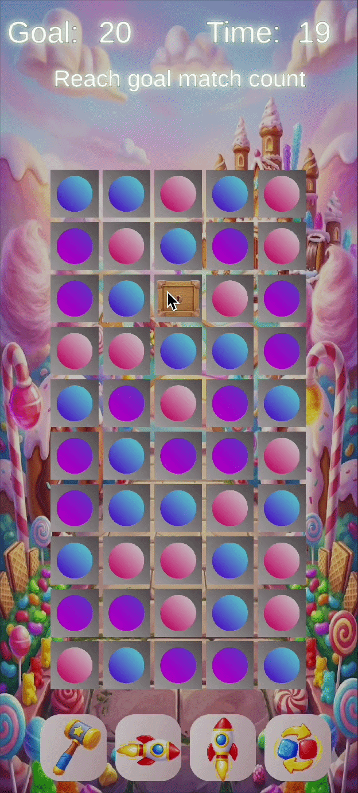

Project Name: My Match3 Game

Description: This is a game project which is in Match3 game genre.

Programming Language: C#

Game Engine: Unity

Project Situation: Work In Progress

Developer, Project Manager, Author, Owner: Muhammet Uymaz

A) Game Mechanics:

The game includes these mechanisms:

1) Swapping,
2) Matching,
3) Be able to make a power-up (like Dynamite) by matching
4) Mechanisms of power-ups:
   4.1) Helicopter: Explodes (reduce health) up, down, right, left pieces
   4.2) Rocket: Explodes (reduce health) all pieces along vertical axis
   4.3) Dynamite: Explodes (reduce health) all pieces as rectangle area
   4.4) Magnate: Explodes (reduce health) all candies which are in the most repeated candy type
5) Mechanism of boosters:
   5.1) Hammer: Explode (reduce health) piece of the selected tile (if the selected tile has a piece)
   5.2) Rocket - Vertical: Explodes (reduce health) all pieces along vertical axis
   5.3) Rocket - Horizontal: Explodes (reduce health) all pieces along horizontal axis
   5.4) Shuffler: Shuffle the board
6) Showing the goal count. Decreasing the goal count by matching the candies.
7) Showing the remaining time.
8) Showing the info: tells player what he should do (e.g: selecting a tile after clicking Hammer booster)
9) Refilling piece system
10) Obstacle piece. It has more than 1 health. Its health is reduced when their adjancent candies are matched
11) Filling empty tile after below candy's exploding animation is done

B) Board

The board is always located center of the screen dynamically.
There is a SpriteMask object above of the board.
The pieces are masked when they are falling by refilling system. So no piece is shown above of the board.

C) Animation System

There is a custom animation system is used.
I built this animation system from scratch.
By use AnimationManager, we can make different animations with different Ease Functions.
The ease types which can be used: Linear, InSine, OutSine, InOutSine, SinWave, OutBounce, InQuint
This system uses Pooling Object design pattern. So an Animation object can be used over and over again, it provides optimization.
Observer design pattern is used, so 2 situation can be observed by other classes (with IAnimationEvents interface):
1) When animation is updating
2) When animation is ended
This system does not causes memory leak.

D) Piece

Piece uses these 2 systems:
1) Entity Component System Architecture
  I built this system from scratch (it is not Unity's ECS system)
  Piece has got different components (e.g: candies can fall but box piece can not fall)
  The system is flexible so new components/systems can be added easily.
  ECS makes the piece system maintainable, flexible and clean.
2) Pooling Object Design Pattern
   A piece can be used over and over again.
   It makes the project optimized.

E) Hint System

It shows the possible matching sequence after a while.

F) Service Locator

It includes the objects of the classes which are reached by other classes.
I used it to not use Singleton Design Pattern over and over again.
It makes the project maintainable, flexible and clean.

G) Timer System

Observer design pattern is used.
It is used to set the time by classes.

H) Game Mode

The game has got 3 modes: TimeBased, StepBased, MatchingGoalBased
StepBased and MatchingGoalBased modes are not added yet.

I) Game State

Game states are controlled by Game Manager. States are: Playing and GameOver.

J) Used Design Patterns
1) Observer Design Pattern
2) Pooling Object Design Pattern
3) Service Locator
   
K) Level Editor

The project has got a Level Editor. It is opened: Windows -> LevelEditor button.
User can enter row, and column of the board and generate the board by clicking "Generate" button. 
The Level Editor is not completed yet.
UnityEditor library is used for this editor.

L) TEST

Tested edge cases for getting tile from board (about array-index)
Game Over, Game Winning cases are tested.
Other some tests are worked on, too.

<h3>Gameplay</h3>

